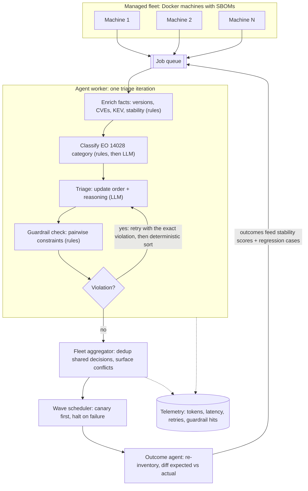

# Scaled Agents Infrastructure

## Task

- Run ReleaseTrain's update-triage agents across a fleet of machines, not one
- Scale two axes: managed machines (containers with SBOMs) and agent runtime (queue plus workers)
- Measure what breaks, what it costs, and what only appears at scale

## Architecture

## Research

- Consistency: same facts on N machines, same answer everywhere?
- Error correlation: one shared decision vs N independent calls (cost vs blast radius)
- Quality under load: what degrades first at provider rate limits?
- Fleet as drift sensor: detect model or prompt drift from daily runs
- Budgeted scheduling: which machine gets an agent first (exposure-hours for KEV-affected machines)
- Canary waves: does outcome feedback reduce fleet-wide breakage?

## Development

- Fleet of Docker "machines" with differing installed software
- SBOM per machine via [releasetrain-inventory](https://pypi.org/project/releasetrain-inventory/)
- Per-machine triage loop reusing ReleaseTrain agents: enrich, classify, triage, guardrails, feedback loop
- Job queue plus horizontally scaled, rate-limit-aware workers
- Fleet aggregator: dedup shared decisions, wave scheduling, conflict surfacing
- Outcome agent: re-inventory after an update, record success or failure
- Telemetry per run: tokens, latency, retries, guardrail activations (LangGraph plus Langfuse)

## Evaluation

- Scale curves: fleet size vs wall-clock, cost, constraint-compliance rate
- Inconsistency rate across identical inputs
- Blast radius of one shared wrong decision vs ensemble accuracy
- Degradation curve: compliance vs offered load (p50 and p99)
- Control charts over daily regression-assert pass rates
- Exposure-hours under different budget policies
- Baselines: sequential single-machine runs; batching on and off; cache on and off
